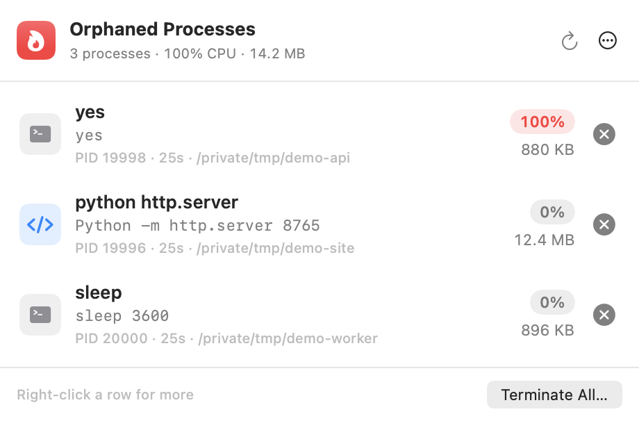

# OrphanBar

A menu bar app that lists processes left running after the process that started them exited,
with what each costs, and ends them.



- Click the menu bar item: each orphan with its CPU (a red capsule at half a core or more),
  memory footprint, PID, uptime, and working folder.
- × sends SIGTERM; ⌥-click × sends SIGKILL. A process that ignores SIGTERM for two seconds gets a
  Force Kill button. Right-click a row to copy its command or PID, show its folder in Finder,
  or ignore its name. **Terminate All…** asks first.
- The menu bar shows the count, and a flame while an orphan burns half a core or more.

## What counts as an orphan

A process you own whose parent is launchd, that launchd doesn't manage. It is not a launchd
job (`launchctl list`), not an app, app extension or XPC service, not part of the OS, and not a
helper of an app that is still running. `ssh-agent`, `gpg-agent`, `keyboxd` and `dirmngr` are
ignored by default (⋯ → Ignored Names).

## Requirements

- macOS 14 or later
- Xcode 16 or later, or the Command Line Tools with Swift 6 (`xcode-select --install`)

## Build

```sh
git clone https://github.com/scr2em/orphan-bar.git
cd orphan-bar
./scripts/build-app.sh --install   # builds build/OrphanBar.app, copies it to ~/Applications, opens it
.build/release/OrphanBar --list    # the same list in the terminal
```

Launch at Login is in the ⋯ menu.

To update, run `git pull` and run the build script again.

## License

MIT. See [LICENSE](LICENSE).
